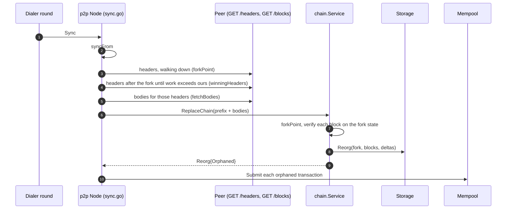

# Life of a reorg

A reorg happens when a peer holds a different branch of the chain that carries
more accumulated work than ours. This page follows one, from the moment the
dialer round starts a sync to the moment the transactions of the dropped blocks
are back in the mempool. Every step names the function that does the work and
the ADR that decided it. It describes the code on `master`; the test in
`guide_test.go` fails when an anchor or an ADR link stops being true.

The decision rule is [ADR-0029](../adr/0029-reorg-by-cumulative-work.md): the
branch with strictly more work after the fork point wins, and PoA blocks weigh 1
each. The transport is [ADR-0019](../adr/0019-initial-sync-and-forks.md): headers
first, bodies only for the prefix that can win.

1. **Detection.** Each dialer round ends with
   `internal/p2p/sync.go:Node.Sync`, which lists the peers whose tip we lack and
   whose height is at least ours, highest first, and tries them until one
   attempt changes the local tip. A peer that serves invalid data is banned;
   one that fails a request is disconnected. See
   [ADR-0019](../adr/0019-initial-sync-and-forks.md) and
   [ADR-0013](../adr/0013-p2p-over-http.md).
2. **One attempt.** `internal/p2p/sync.go:Node.syncFrom` finds the fork point
   and, when the peer's chain diverges below our tip, runs the reorg; it then
   extends the chain with the peer's remaining blocks through `AcceptBlock`.
   When the peer only extends our tip there is no reorg and only the extension
   runs. See [ADR-0019](../adr/0019-initial-sync-and-forks.md).
3. **Fork point.** `internal/p2p/sync.go:Node.forkPoint` fetches the peer's
   headers in windows of `HeaderBatch` going down from the lower of the two tips
   and returns the highest height where our hash and the peer's hash are equal.
   If not even the genesis matches, the peer is banned. See
   [ADR-0019](../adr/0019-initial-sync-and-forks.md).
4. **Cumulative work.** `internal/p2p/sync.go:Node.winningHeaders` fetches the
   peer's headers after the fork point, checking each against the previous one,
   and adds their work (`domain.BlockWork`) until the sum is strictly greater
   than the work of our local tail (`domain.ChainWork`). It stops at the first
   such header, so a long branch is not downloaded whole. If the peer's headers
   end first, it returns `ErrInsufficientWork`: the peer's branch has less or
   equal work, nothing is written, and we keep our chain (equal work does not
   switch, so two nodes do not flip-flop). See
   [ADR-0029](../adr/0029-reorg-by-cumulative-work.md) and
   [ADR-0008](../adr/0008-difficulty-retargeting.md).
5. **Bodies.** `internal/p2p/sync.go:Node.fetchBodies` downloads the bodies of
   those headers in batches of `BodyBatch` and checks each one against its
   header (index, hash) and its transaction list against the Merkle root. A
   mismatch is misbehaviour; a header without a body means the peer pruned it
   (`ErrPeerPruned`), which is not a ban. See
   [ADR-0019](../adr/0019-initial-sync-and-forks.md) and
   [ADR-0031](../adr/0031-snapshots-and-pruning.md).
6. **Handing the candidate over.** `Node.reorg` joins our own blocks up to the
   fork with the peer's bodies and passes the whole chain to
   `internal/chain/service.go:Service.ReplaceChain`, which takes the write turn
   and finds `internal/chain/service.go:forkPoint` on its own, again: it never
   trusts the peer's claim. A candidate that ends where the chains still agree,
   or that does not start at our genesis, is refused. See
   [ADR-0029](../adr/0029-reorg-by-cumulative-work.md).
7. **Verifying the branch.** `internal/chain/service.go:Service.ReplaceChain` starts from the UTXO set as it was at
   the fork (`ForkState`, which fails with `ErrReorgTooDeep` below the pruned
   history) and checks each candidate block in order: consensus `Verify`,
   `ValidateBlockRules`, `BlockDelta`, input signatures and the contract delta,
   applying each delta to the fork state before the next block. The first
   failure returns its error with nothing written. After the loop it compares
   `ChainWork` of the candidate with that of the local tail once more and
   returns `ErrInsufficientWork` unless the candidate is strictly heavier. See
   [ADR-0029](../adr/0029-reorg-by-cumulative-work.md) and
   [ADR-0031](../adr/0031-snapshots-and-pruning.md).
8. **The swap.** `ReplaceChain` calls `Reorg` on the repository, for example
   `internal/storage/bolt/indexed.go:Repository.Reorg`: in one atomic step it
   reverts, from the tip down to the fork, the stored deltas of the dropped
   blocks, drops them and commits the candidate blocks with their deltas. It is
   the atomic `ReplaceFrom` of the ADR plus the UTXO and index updates; a crash
   or an error cannot leave a mixed chain. A failure other than a tip conflict
   stops the service. See [ADR-0029](../adr/0029-reorg-by-cumulative-work.md)
   and [ADR-0011](../adr/0011-persisted-indexes.md).
9. **Orphans.** `internal/chain/service.go:orphaned` lists, in chain order, the
   transactions of the dropped blocks that no connected block holds, matched by
   hash, and `ReplaceChain` returns them in `Reorg.Orphaned`. The pool is not
   revalidated here. See [ADR-0029](../adr/0029-reorg-by-cumulative-work.md).
10. **Back to the mempool.** The node's ledger adapter,
    `cmd/bwg/p2p.go:syncLedger.ReplaceChain`, publishes the connected blocks and
    submits every orphaned transaction through `Service.Submit`, ignoring
    refusals: a transaction the new branch already mined, or one whose inputs no
    longer exist, is dropped. The rest wait in the pool for the next block. See
    [ADR-0029](../adr/0029-reorg-by-cumulative-work.md) and
    [ADR-0028](../adr/0028-mempool.md).

Previous: [Life of a transaction](transaction.md).
