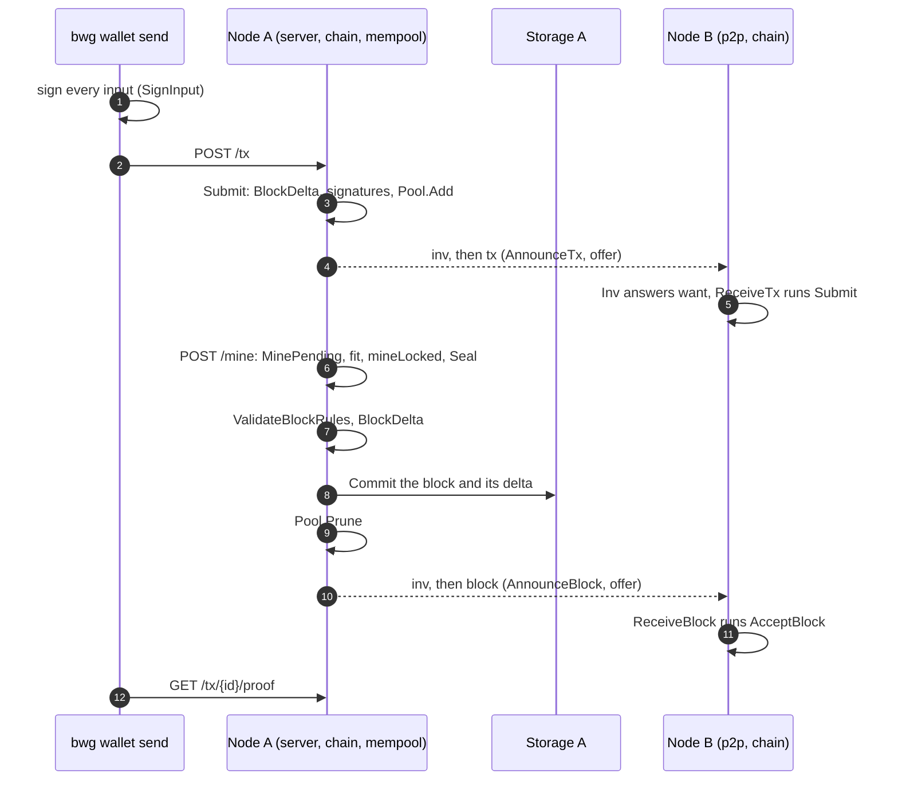

# Life of a transaction

This page follows one payment from the moment a wallet signs it to the moment a
reader can prove it is in a block. Every step names the function that does the
work and the ADR that decided it. It describes the code on `master`; the
test in `guide_test.go` fails when an anchor or an ADR link stops being true.

The cast: a wallet (`bwg wallet send`), node A (where the transaction is
submitted and mined), node B (a peer), and the storage behind each node.

1. **Signing.** `bwg wallet send` reads the sender's UTXOs from the node, and
   `cmd/bwg/transfer.go:buildTransfer` picks inputs until
   they cover amount plus fee, adds a change output, then signs each input with
   `internal/domain/transaction.go:SignInput`. The signature covers the
   transaction hash, which does not include the signatures themselves. The
   model is [ADR-0001](../adr/0001-utxo-model.md); the CLI is the composition
   root of [ADR-0016](../adr/0016-bwg-cli-composition-root.md) and the keys come
   from the wallet of [ADR-0017](../adr/0017-hd-wallet-slip10.md).
2. **`POST /tx`.** The wallet sends the transaction through the generated client.
   `internal/server/server.go:Server.handleSubmitTx` decodes the body, fills an
   empty ID and rejects a wrong ID or a missing timestamp with 400 (`checkTx`),
   then calls the chain. It never mines. The route is part of the contract of
   [ADR-0007](../adr/0007-openapi-contract.md).
3. **Admission.** `internal/chain/service.go:Service.Submit` applies to the
   transaction the checks `Mine` applies to a block of that one transaction,
   against the confirmed UTXO set: `BlockDelta` (inputs exist, `in >= out`),
   the input signatures, and the contract rules. It does not take the write
   turn, so it never waits for mining. It then computes the fee and calls
   `internal/mempool/mempool.go:Pool.Add`, which rejects a duplicate ID
   (`ErrDuplicate`) or an input already spent by another pooled transaction
   (`ErrConflict`), and evicts or refuses the lowest fee rate when the pool is
   full (`ErrFull`). See [ADR-0028](../adr/0028-mempool.md) and
   [ADR-0001](../adr/0001-utxo-model.md).
4. **Gossip out.** After admission the handler publishes the event and calls
   `internal/p2p/gossip.go:Node.AnnounceTx`, which marks the hash as seen and
   queues it without blocking. The relay worker calls
   `internal/p2p/gossip.go:Node.offer` for each connected peer with an address:
   it posts an `inv` with the hash and sends the transaction only if the peer
   answers that it wants it. See [ADR-0018](../adr/0018-block-and-tx-gossip.md).
5. **Gossip in.** On the peer, `internal/p2p/gossip.go:Node.Inv` answers the
   `inv` with the items it does not know (not seen, not in the pool, not
   mined), and `internal/p2p/gossip.go:Node.ReceiveTx` runs the same
   `Service.Submit` through the ledger port. A transaction the peer rejects is
   not relayed; an accepted one is relayed to everyone except its origin. See
   [ADR-0018](../adr/0018-block-and-tx-gossip.md) and
   [ADR-0013](../adr/0013-p2p-over-http.md).
6. **Selecting what to mine.** `POST /mine` calls
   `internal/chain/service.go:Service.MinePending`, which takes the write turn
   and calls `internal/chain/service.go:Service.fit`. `fit` asks the pool for the
   transactions of best fee per byte that fit `MaxBlockBytes` once sealed,
   shrinking the budget until the block fits; stale transactions are then
   dropped from the pool (`dropStale`). See
   [ADR-0028](../adr/0028-mempool.md) and
   [ADR-0032](../adr/0032-max-block-bytes-constant.md).
7. **Building and sealing.** `internal/chain/service.go:Service.mineLocked` (the
   write turn is held) computes the delta, puts the coinbase at position 0 when
   `MINER_ADDRESS` is set (subsidy plus fees), verifies the signatures, then
   hands the transactions to the block generator, which calls the consensus
   `Seal`; for proof of work that is
   `internal/consensus/pow/pow.go:ProofOfWork.Seal`, the parallel, cancellable
   search for a hash with enough leading zero bits. See
   [ADR-0015](../adr/0015-coinbase-and-halving.md) and
   [ADR-0012](../adr/0012-difficulty-bits.md).
8. **Block validation.** Still in `mineLocked`, the sealed block goes through
   `internal/domain/rules.go:ValidateBlockRules` (size, Merkle root, timestamp
   above the median of the last blocks) and the consensus `Verify`. The UTXO
   effect of the block comes from `internal/domain/utxo.go:BlockDelta`, which
   rejects a missing or doubly spent input and a coinbase larger than subsidy
   plus fees. See [ADR-0009](../adr/0009-merkle-tree.md),
   [ADR-0034](../adr/0034-median-time-past.md) and
   [ADR-0015](../adr/0015-coinbase-and-halving.md).
9. **Storage.** `mineLocked` calls `Commit` on the repository, for example
   `internal/storage/bolt/indexed.go:Repository.Commit`: one atomic step that
   does what `Append` does (the block must extend the tip) and also applies the
   delta and updates the indexes. A write failure other than a tip conflict marks
   the service diverged and stops it (`writeFailed`) instead of going on with
   an unknown state. See
   [ADR-0004](../adr/0004-disk-storage.md) and
   [ADR-0011](../adr/0011-persisted-indexes.md).
10. **Pruning the pool.** Right after the commit,
    `internal/mempool/mempool.go:Pool.Prune` removes the transactions the block
    holds and every pooled transaction whose input the UTXO set no longer
    holds. See [ADR-0028](../adr/0028-mempool.md).
11. **Block gossip out.** The handler of `POST /mine` calls
    `internal/p2p/gossip.go:Node.AnnounceBlock`, which uses the same `inv`,
    `want`, send path as the transaction. See
    [ADR-0018](../adr/0018-block-and-tx-gossip.md).
12. **Block gossip in.** On node B, `internal/p2p/gossip.go:Node.ReceiveBlock`
    calls `internal/chain/service.go:Service.AcceptBlock`. The block must extend
    the tip (`ErrNotOnTip` otherwise, and the sync of
    [the reorg guide](reorg.md) takes over); then it gets the same checks as
    a mined block, in the same order, and `Prune` removes the transaction from
    B's pool. See [ADR-0018](../adr/0018-block-and-tx-gossip.md) and
    [ADR-0019](../adr/0019-initial-sync-and-forks.md).
13. **Inclusion proof.** `GET /tx/{id}/proof` is served by
    `internal/server/server.go:Server.handleGetTxProof`, which calls
    `internal/chain/service.go:Service.TxProof`. It finds the block through the
    transaction index and returns the leaf and the sibling hashes up to the
    block's `MerkleRoot`; the reader recomputes the root and compares it with
    the header. See [ADR-0009](../adr/0009-merkle-tree.md) and
    [ADR-0011](../adr/0011-persisted-indexes.md).

Next: [Life of a reorg](reorg.md).
